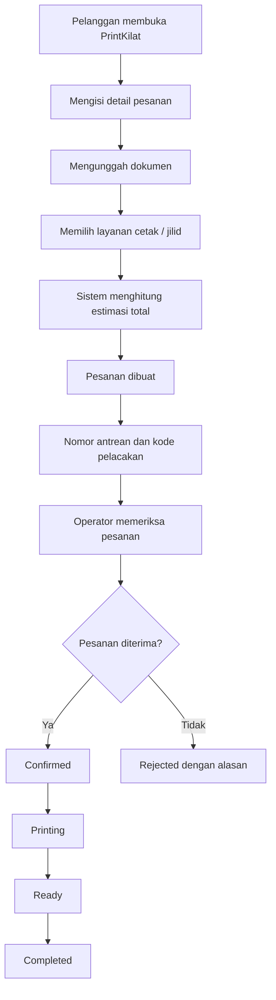
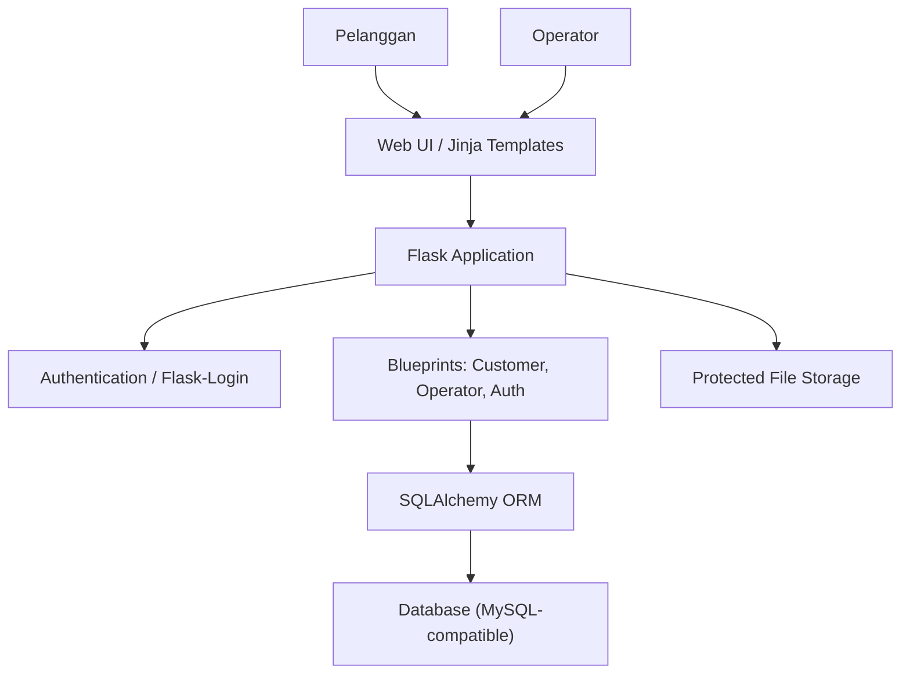
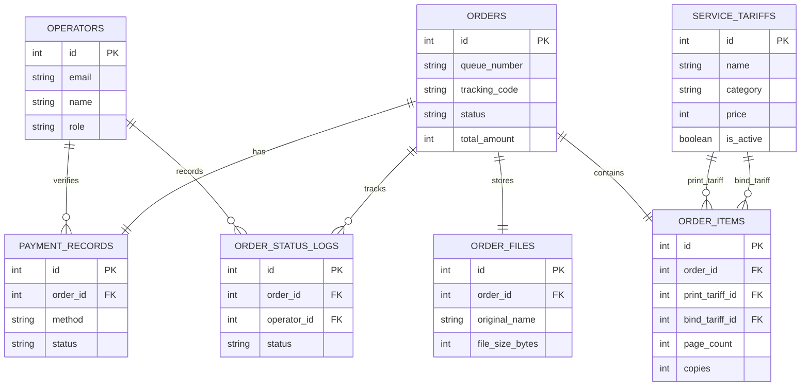

# PrintKilat

**PrintKilat** adalah aplikasi web pemesanan layanan cetak dan jilid dokumen, dengan portal pelanggan dan portal operator untuk mengelola antrean pesanan.

## Fitur

- Pemesanan dokumen dari portal pelanggan.
- Pengunggahan file dokumen dan deteksi jumlah halaman PDF.
- Pilihan tarif cetak dan jilid serta kalkulasi total.
- Nomor antrean dan kode pelacakan pesanan.
- Pelacakan status pesanan.
- Portal operator untuk pengelolaan antrean dan pesanan.
- Verifikasi pembayaran dan pengelolaan tarif.

## Diagram Alur Pesanan



## Diagram Arsitektur Sistem



## Diagram Entitas (ERD Ringkas)



## Status Pesanan

`pending` → `confirmed` → `printing` → `ready` → `completed`

Status `rejected` juga tersedia, dengan alasan penolakan.

## Teknologi

| Komponen | Teknologi |
|---|---|
| Backend | Python, Flask 3 |
| Template | Jinja2 |
| ORM | Flask-SQLAlchemy, SQLAlchemy |
| Database driver | PyMySQL |
| Database migration | Flask-Migrate, Alembic |
| Authentication | Flask-Login |
| Form & CSRF | Flask-WTF, WTForms |
| PDF | pypdf |
| Testing | pytest |
| Konfigurasi | python-dotenv |

## Struktur Proyek

| Path | Fungsi |
|---|---|
| `app/__init__.py` | Application factory dan registrasi blueprint |
| `app/models.py` | Model database |
| `app/blueprints/customer.py` | Rute dan proses portal pelanggan |
| `app/blueprints/operator.py` | Rute pengelolaan pesanan operator |
| `app/blueprints/auth.py` | Autentikasi operator |
| `app/templates/` | Template antarmuka |
| `app/static/` | CSS dan JavaScript |
| `app/extensions.py` | Inisialisasi extension |
| `app/seed.py` | Data awal |
| `config.py` | Konfigurasi aplikasi |
| `requirements.txt` | Dependensi Python |

## Menjalankan secara Lokal

1. Clone repository:

   ```bash
   git clone https://github.com/Attariqul/Printkilat.git
   cd Printkilat
   ```

2. Buat virtual environment:

   ```bash
   python -m venv .venv
   ```

3. Aktifkan virtual environment:

   **Windows:**
   ```bash
   .venv\Scripts\activate
   ```

   **Linux/macOS:**
   ```bash
   source .venv/bin/activate
   ```

4. Instal dependensi:

   ```bash
   pip install -r requirements.txt
   ```

5. Siapkan konfigurasi environment sesuai `config.py` dan `.env.example`. Jangan memasukkan credential, secret, atau data pelanggan ke Git.

6. Jalankan aplikasi sesuai entry point dan konfigurasi deployment pada repository.

## Keamanan dan Privasi

- Akses portal operator dilindungi autentikasi.
- Dokumen pelanggan disimpan pada lokasi penyimpanan terlindungi sesuai konfigurasi aplikasi.
- Jangan membagikan berkas pesanan, bukti pembayaran, credential, atau informasi pribadi pelanggan pada repository publik.
- Konfigurasi penyimpanan dan retensi file perlu diverifikasi pada lingkungan deployment.

## Konteks Proyek

PrintKilat dikembangkan sebagai proyek akademik dengan studi kasus layanan fotokopi dan percetakan, untuk membantu proses pemesanan, pengelolaan antrean, tarif layanan, dan status pekerjaan.

---

> Dokumentasi ini merupakan ringkasan. Untuk rincian implementasi dan konfigurasi, lihat source code repository.
