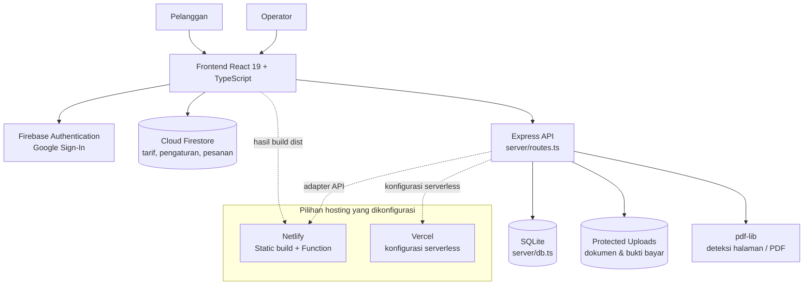
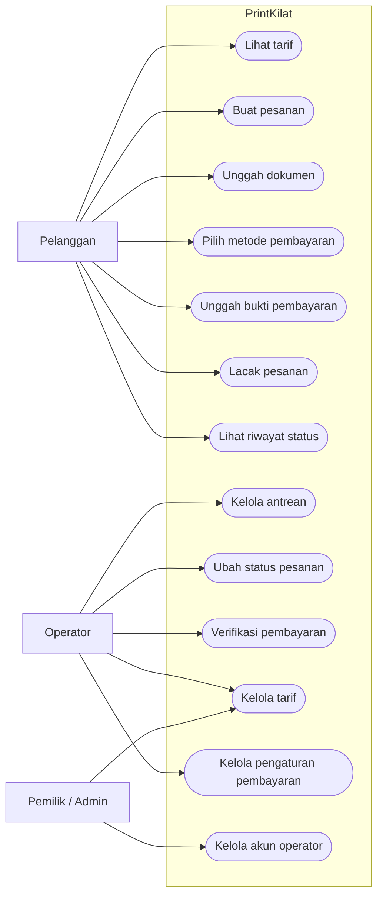
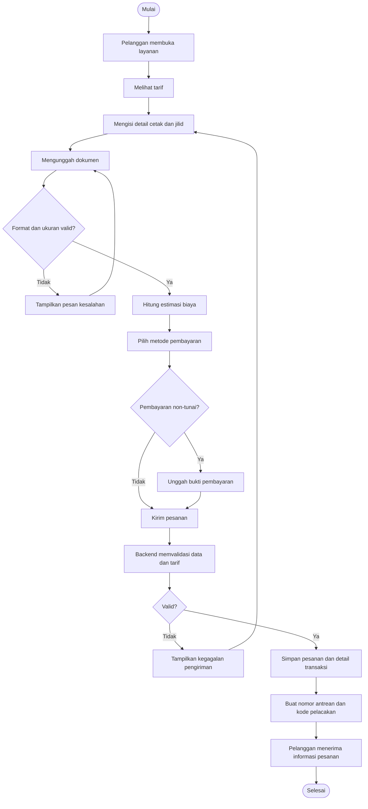
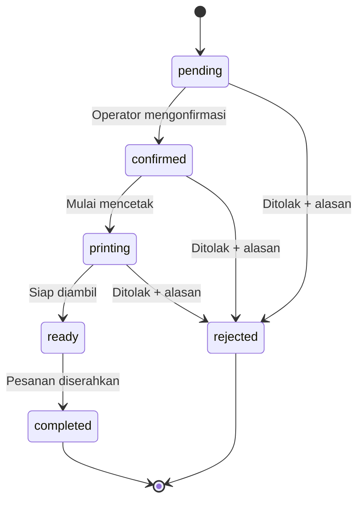
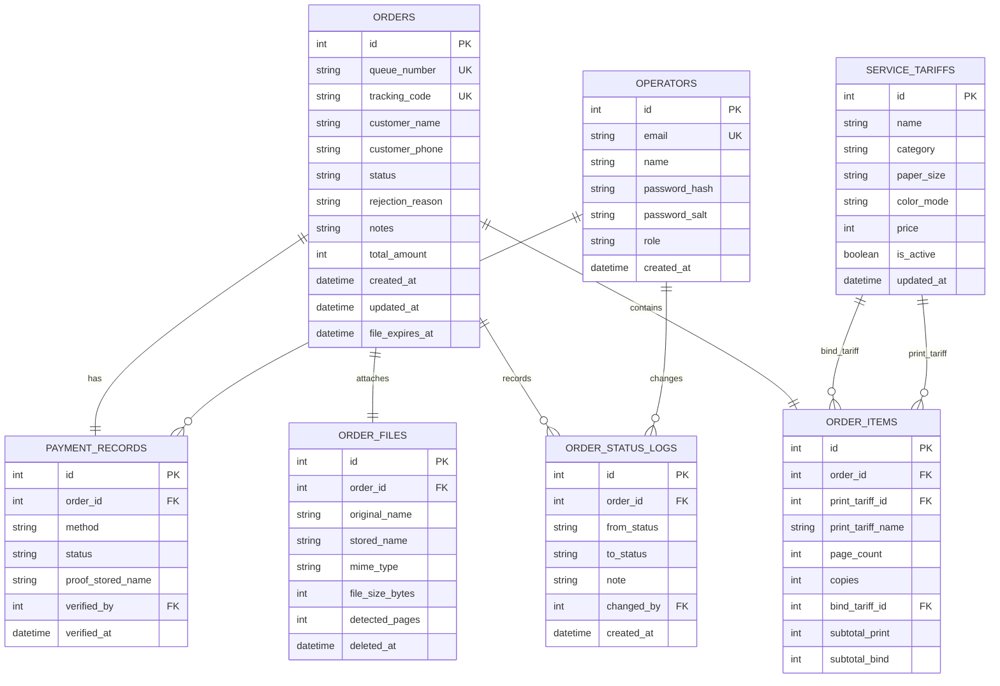
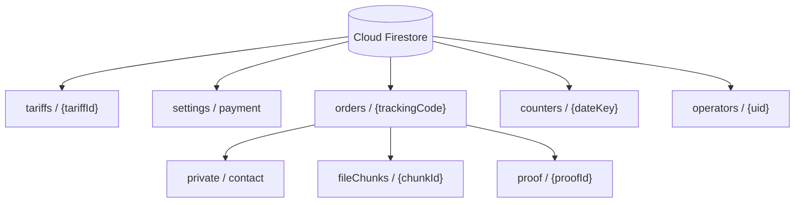

# PrintKilat

<p align="center">
  <strong>Platform Pemesanan dan Pengelolaan Layanan Cetak Dokumen</strong><br/>
  Aplikasi web untuk mempermudah pelanggan mengirim pesanan cetak, memantau antrean, dan membantu operator mengelola proses layanan.
</p>

<p align="center">
  
  
  
  
  
</p>

---

## Daftar Isi

- [Tentang Proyek](#tentang-proyek)
- [Fitur Utama](#fitur-utama)
- [Peran Pengguna](#peran-pengguna)
- [Alur Sistem](#alur-sistem)
- [Arsitektur](#arsitektur)
- [Diagram Use Case](#diagram-use-case)
- [Diagram Aktivitas Pemesanan](#diagram-aktivitas-pemesanan)
- [Diagram Status Pesanan](#diagram-status-pesanan)
- [Diagram ERD](#diagram-erd)
- [Model Data Firebase](#model-data-firebase)
- [Teknologi](#teknologi)
- [Struktur Direktori](#struktur-direktori)
- [Persyaratan Sistem](#persyaratan-sistem)
- [Instalasi dan Menjalankan Aplikasi](#instalasi-dan-menjalankan-aplikasi)
- [Konfigurasi Lingkungan](#konfigurasi-lingkungan)
- [API Ringkas](#api-ringkas)
- [Keamanan](#keamanan)
- [Pengujian](#pengujian)
- [Deployment](#deployment)
- [Catatan Teknis dan Batasan](#catatan-teknis-dan-batasan)
- [Kontribusi](#kontribusi)

---

## Tentang Proyek

**PrintKilat** adalah aplikasi web untuk layanan pemesanan cetak dan jilid dokumen. Aplikasi menyediakan jalur layanan pelanggan dan jalur operasional untuk operator gerai.

Pelanggan dapat melihat tarif, mengisi detail pekerjaan cetak, mengunggah dokumen, menentukan metode pembayaran, memperoleh nomor antrean dan kode pelacakan, serta memantau perkembangan pesanan. Operator menggunakan portal terpisah untuk mengelola antrean, tarif, pembayaran, dan proses pengerjaan.

Repository saat ini memuat implementasi frontend React/TypeScript dengan backend Express/TypeScript, penyimpanan SQLite lokal pada backend, serta integrasi Firebase Authentication dan Cloud Firestore pada frontend. Terdapat pula direktori aplikasi Flask terpisah di repository; konfigurasi dan dependensinya tetap disertakan, tetapi jalur aplikasi utama yang dijalankan oleh script npm adalah server Express.

> **Status proyek:** dalam pengembangan. Periksa konfigurasi deployment dan layanan yang benar-benar aktif sebelum menggunakan aplikasi untuk operasional produksi.

## Fitur Utama

### Pelanggan

- Portal masuk untuk melanjutkan sebagai pelanggan.
- Melihat daftar tarif cetak dan jilid.
- Membuat pesanan dengan memilih jenis tarif, ukuran kertas, mode warna, jumlah halaman, jumlah salinan, serta opsi jilid.
- Mengunggah dokumen berformat PDF, DOC, atau DOCX dengan batas ukuran 20 MB.
- Memilih pembayaran tunai, QR/QRIS, atau transfer sesuai konfigurasi dan alur antarmuka.
- Mengirim bukti pembayaran untuk metode non-tunai.
- Mendapatkan nomor antrean harian dengan format `PK-YYYYMMDD-NNN`.
- Mendapatkan kode pelacakan dengan format `PK-TRK-XXXXXXXX`.
- Melihat status pesanan dan riwayat perubahannya.
- Mengunggah atau mengganti bukti pembayaran melalui halaman pelacakan sesuai aturan sistem.

### Operator

- Masuk ke portal operator.
- Melihat daftar dan detail antrean pesanan.
- Memproses perubahan status pesanan sesuai urutan yang diizinkan.
- Menolak pesanan dengan alasan penolakan.
- Mengelola tarif cetak dan jilid.
- Memeriksa dan memverifikasi pembayaran.
- Mengelola pengaturan informasi pembayaran yang digunakan pelanggan.

### Pengelolaan berkas

- Validasi ekstensi dan ukuran berkas pada proses unggah.
- Dokumen pesanan dan bukti pembayaran disimpan di direktori unggahan terlindungi pada backend Express.
- Berkas memiliki masa retensi tujuh hari; proses pembersihan dijadwalkan saat server berjalan.
- PDF dapat dianalisis untuk mendeteksi jumlah halaman.

## Peran Pengguna

| Peran | Tanggung jawab |
|---|---|
| Pelanggan/tamu | Melihat tarif, mengirim pesanan, mengunggah dokumen dan bukti pembayaran, serta melacak pesanan menggunakan kode pelacakan. |
| Operator | Mengelola antrean, memperbarui status pesanan, mengelola tarif, dan memverifikasi pembayaran. |
| Pemilik/admin | Mengelola otorisasi akun operator dan konfigurasi tingkat administratif yang tersedia. |

## Alur Sistem

1. Pelanggan membuka portal PrintKilat dan memilih layanan pelanggan.
2. Pelanggan melihat tarif, mengisi rincian cetak/jilid, dan mengunggah dokumen.
3. Sistem memvalidasi berkas dan menghitung total biaya.
4. Pelanggan memilih metode pembayaran. Untuk pembayaran QR/QRIS atau transfer, bukti pembayaran diperlukan sesuai validasi aplikasi.
5. Backend membuat pesanan, nomor antrean, dan kode pelacakan.
6. Operator memeriksa antrean dan mengonfirmasi pesanan.
7. Operator memproses pencetakan dan memperbarui status secara bertahap.
8. Pelanggan memantau perkembangan menggunakan kode pelacakan.
9. Pesanan berakhir pada status selesai atau ditolak.

## Arsitektur

Diagram berikut menggambarkan komponen utama yang terlihat pada repository. Integrasi Firebase untuk autentikasi operator dan data katalog/pengaturan berada pada frontend, sedangkan API Express menggunakan SQLite dan penyimpanan berkas lokal. Deployment Netlify menggunakan Netlify Function sebagai adapter API.



**Catatan:** repository juga berisi aplikasi Flask (`app/`, `run.py`, `config.py`, `requirements.txt`) dan adapter `api/index.py`. Keduanya tidak menjadi entry point script npm utama. Pastikan memilih satu jalur deployment secara sadar dan jangan menganggap data SQLite pada filesystem sementara serverless bersifat persisten.

## Diagram Use Case



## Diagram Aktivitas Pemesanan



## Diagram Status Pesanan

Status dikelola sebagai *state machine*. Perubahan status tidak dapat melompati tahap proses yang ditetapkan.



| Status internal | Label antarmuka | Makna |
|---|---|---|
| `pending` | Menunggu Konfirmasi | Pesanan baru diterima sistem. |
| `confirmed` | Dikonfirmasi | Pesanan telah dikonfirmasi operator. |
| `printing` | Sedang Dicetak | Pesanan sedang dikerjakan. |
| `ready` | Siap Diambil | Pekerjaan telah selesai dan siap diserahkan. |
| `completed` | Selesai | Pesanan telah dituntaskan. |
| `rejected` | Ditolak | Pesanan ditolak; alasan wajib diberikan. |

Status `completed` dan `rejected` merupakan status terminal. Status `ready` hanya dapat dilanjutkan menjadi `completed`.

## Diagram ERD

ERD berikut merangkum tabel SQLite pada implementasi Express. Relasi utama menggunakan `orders.id`; data pesanan juga memiliki `tracking_code` unik untuk pencarian pelanggan.



**Interpretasi relasi:**
- Satu pesanan memiliki satu detail item, satu berkas, dan satu catatan pembayaran.
- Satu pesanan dapat memiliki banyak catatan perubahan status.
- Tarif cetak dan tarif jilid direferensikan dari `service_tariffs`.
- Operator dapat memverifikasi pembayaran dan mencatat perubahan status.

## Model Data Firebase

Selain skema SQLite backend, repository menyediakan `firebase-blueprint.json` dan `firestore.rules` untuk model data Firestore. Keduanya merupakan model integrasi terpisah; jangan mencampurkan nama koleksi Firestore dengan tabel SQLite.



| Koleksi / dokumen | Kegunaan |
|---|---|
| `tariffs/{tariffId}` | Tarif cetak dan jilid. |
| `settings/payment` | Pengaturan QR/QRIS dan rekening pembayaran. |
| `orders/{trackingCode}` | Data pesanan dan status. |
| `orders/{trackingCode}/private/contact` | Informasi kontak pelanggan yang dibatasi. |
| `orders/{trackingCode}/fileChunks/{chunkId}` | Potongan data dokumen. |
| `orders/{trackingCode}/proof/{proofId}` | Bukti pembayaran. |
| `counters/{dateKey}` | Pencacah nomor antrean harian. |
| `operators/{uid}` | Profil otorisasi operator. |

Aturan keamanan Firestore mengatur pembacaan daftar pesanan untuk operator, validasi struktur dokumen, pembatasan perubahan status, serta isolasi data kontak dan berkas. Implementasi route Express saat ini tetap menggunakan SQLite dan direktori berkas lokal; pemilihan backend aktif perlu diperhatikan ketika membaca diagram ini.

## Teknologi

| Lapisan | Teknologi yang terdeteksi |
|---|---|
| Frontend | React 19, TypeScript, Vite 8 |
| Styling | Tailwind CSS 4 |
| Ikon dan animasi | lucide-react, Motion |
| Backend utama | Node.js, Express 4, TypeScript, tsx |
| Database backend | SQLite melalui `node:sqlite` |
| Autentikasi frontend | Firebase Authentication, Google provider |
| Database cloud | Cloud Firestore dan Firestore Security Rules |
| Dokumen | pdf-lib |
| Upload | Multer |
| Deployment web | Netlify configuration dan Vercel configuration |
| Pengujian | Node test runner untuk logic TypeScript; pytest untuk direktori Flask |

## Struktur Direktori

```text
Printkilat/
├── api/
│   └── index.py                 # Adapter entry point Python/serverless
├── app/                         # Aplikasi Flask terpisah
│   ├── blueprints/              # Auth, customer, operator
│   ├── templates/
│   ├── static/
│   ├── models.py
│   ├── seed.py
│   └── utils.py
├── netlify/
│   └── functions/
│       └── api.ts               # Adapter Express ke Netlify Function
├── public/
│   └── assets/
├── server/
│   ├── auth.ts                  # Autentikasi dan sesi operator API
│   ├── db.ts                    # Skema SQLite, query, seed, retensi berkas
│   └── routes.ts                # Endpoint API
├── src/
│   ├── components/              # Komponen UI pelanggan dan operator
│   ├── lib/
│   │   └── firebase.ts          # Firebase client initialization
│   ├── shared/
│   │   ├── printLogic.ts        # Tipe, aturan status, kalkulasi, validasi
│   │   └── printLogic.test.ts   # Unit test aturan bisnis
│   ├── utils/
│   │   └── api.ts               # Client API
│   ├── App.tsx
│   └── main.tsx
├── tests/
│   └── test_printkilat.py       # Pengujian aplikasi Flask
├── config.py
├── run.py                       # Entrypoint Flask
├── server.ts                    # Entrypoint Express + Vite
├── package.json
├── requirements.txt
├── firebase-blueprint.json
├── firebase-applet-config.json
├── firestore.rules
├── security_spec.md
├── netlify.toml
├── vercel.json
└── README.md
```

## Persyaratan Sistem

Untuk menjalankan jalur aplikasi utama berbasis Express:

- Node.js versi 22 atau lebih baru direkomendasikan (konfigurasi Netlify menetapkan Node 22).
- npm atau Bun sebagai pengelola dependensi. Repository menyediakan `package-lock.json` dan `bun.lock`.
- Browser modern.
- Konfigurasi Firebase yang sesuai untuk fungsi autentikasi dan Firestore yang digunakan frontend.

## Instalasi dan Menjalankan Aplikasi

### 1. Clone repository

```bash
git clone https://github.com/Attariqul/Printkilat.git
cd Printkilat
```

### 2. Pasang dependensi

Dengan npm:

```bash
npm install
```

Atau dengan Bun:

```bash
bun install
```

### 3. Siapkan konfigurasi lingkungan

Buat file `.env` berdasarkan `.env.example`, kemudian isi nilai yang diperlukan. Jangan mengunggah file `.env` ke repository.

### 4. Jalankan mode pengembangan

```bash
npm run dev
```

Script tersebut menjalankan `server.ts`, yang menjalankan API Express dan Vite dalam middleware mode. Secara default aplikasi tersedia pada:

```text
http://localhost:3000
```

### 5. Build untuk produksi

```bash
npm run build
```

Hasil build frontend berada pada direktori `dist/`.

### 6. Jalankan pemeriksaan tipe dan pengujian logic

```bash
npm run lint
npm test
```

> Script `lint` menjalankan TypeScript compiler dalam mode pemeriksaan, bukan ESLint. Script `test` menjalankan test suite `src/shared/printLogic.test.ts`.

## Konfigurasi Lingkungan

Variabel yang tersedia pada `.env.example`:

| Variabel | Fungsi |
|---|---|
| `DATABASE_URL` | URI database untuk konfigurasi Flask. |
| `FIREBASE_API_KEY` | Placeholder konfigurasi Firebase; konfigurasi frontend saat ini diimpor dari `firebase-applet-config.json`. |
| `FLASK_ENV` | Mode aplikasi Flask. |
| `FLASK_SECRET_KEY` | Secret key aplikasi Flask. |
| `GEMINI_API_KEY` | Kunci API Gemini jika fitur terkait digunakan. |
| `PORT` | Port server; server Express default 3000. |
| `SESSION_SECRET` | Placeholder secret sesi. Periksa implementasi aktual sebelum mengandalkannya. |
| `STORE_NAME` | Nama gerai untuk konfigurasi Flask. |
| `OPERATIONAL_HOURS` | Informasi jam operasional untuk konfigurasi Flask. |
| `STORE_LOCATION` | Informasi lokasi gerai untuk konfigurasi Flask. |
| `TRANSFER_ACCOUNT_INFO` | Informasi transfer untuk konfigurasi Flask. |

Konfigurasi server TypeScript juga menggunakan beberapa environment variable untuk port, mode produksi, dan konfigurasi sesi. Lihat `server/auth.ts`, `server/db.ts`, serta `server.ts` sebelum menyiapkan deployment.

**Penting:** `config.py` memiliki nilai default pengembangan, termasuk secret dan informasi pembayaran contoh. Ganti semua nilai tersebut sebelum produksi. Jangan memasukkan kredensial, nomor rekening pribadi, token, atau secret ke README maupun commit publik.

## API Ringkas

Endpoint di bawah merupakan endpoint yang terlihat pada implementasi `server/routes.ts`. Prefix lokal adalah `/api`.

| Method | Endpoint | Keterangan |
|---|---|---|
| GET | `/api/health` | Pemeriksaan kesehatan API. |
| GET | `/api/tariffs` | Mengambil daftar tarif. |
| POST | `/api/orders` | Membuat pesanan beserta unggahan dokumen dan, bila ada, bukti pembayaran. |
| GET | `/api/orders/track/:trackingCode` | Melacak pesanan berdasarkan kode. |
| POST | `/api/orders/track/:trackingCode/proof` | Mengunggah bukti pembayaran untuk pesanan. |

Endpoint operator dan endpoint lanjutan tersedia pada router yang sama. Lihat `server/routes.ts` untuk daftar route, metode HTTP, parameter, dan ketentuan autentikasi paling mutakhir.

## Keamanan

Aspek keamanan yang terlihat pada implementasi dan spesifikasi repository:

- Batas ukuran unggahan dokumen sebesar 20 MB.
- Validasi ekstensi dokumen PDF, DOC, dan DOCX.
- Direktori unggahan terpisah dari aset publik pada backend Express.
- Cookie sesi operator dikonfigurasi dengan atribut keamanan pada implementasi autentikasi.
- Password operator pada backend Express disimpan sebagai hash dan salt, bukan teks biasa.
- Transisi status pesanan divalidasi melalui aturan bisnis.
- Aturan Firestore membatasi enumerasi pesanan, akses informasi kontak, dokumen, dan bukti pembayaran kepada operator terverifikasi.
- Dokumen memiliki masa retensi tujuh hari pada mekanisme pembersihan backend.

**Tindakan sebelum produksi:**
1. Ganti secret default dan kredensial akun awal.
2. Tinjau seluruh aturan Firestore dan lakukan pengujian dengan Firebase Emulator atau proyek uji.
3. Pastikan file pelanggan tidak dapat diakses melalui static hosting atau URL publik.
4. Gunakan storage persisten dan database yang sesuai untuk lingkungan serverless. Direktori `/tmp` pada function bukan penyimpanan permanen.
5. Jangan mengekspos konfigurasi pembayaran contoh sebagai rekening aktif.
6. Rotasi kredensial yang pernah ter-commit apabila berisi data sensitif. Hapus atau batasi akses terhadap data tersebut; menghapusnya dari versi terbaru saja tidak menghapus riwayat Git.

Dokumen pendukung: [security_spec.md](./security_spec.md) dan [firestore.rules](./firestore.rules).

## Pengujian

Pengujian logic TypeScript mencakup beberapa aspek berikut:

- Perhitungan subtotal cetak dan jilid.
- Validasi jumlah halaman, jumlah salinan, dan tarif.
- Format rupiah dan nomor antrean.
- Pembentukan kode pelacakan.
- Validasi jenis dan ukuran unggahan.
- Aturan transisi status.
- Persyaratan bukti pembayaran.
- Perhitungan jumlah chunk dokumen.

Jalankan:

```bash
npm test
```

Untuk suite Flask yang terpisah, siapkan environment Python dan dependensinya terlebih dahulu:

```bash
python -m venv .venv
```

Aktifkan virtual environment, lalu:

```bash
pip install -r requirements.txt
pytest
```

Pengujian Flask tidak otomatis menguji backend Express. Keduanya perlu dievaluasi sesuai jalur aplikasi yang dipilih.

## Deployment

### Netlify

Repository menyediakan `netlify.toml` dengan konfigurasi:

- Build command: `npm run build`.
- Publish directory: `dist`.
- Direktori function: `netlify/functions`.
- Node.js: 22.
- Redirect `/api/*` ke Netlify Function API.
- Fallback rute frontend ke `index.html`.

Langkah umum:

1. Hubungkan repository GitHub ke Netlify.
2. Pastikan build command dan publish directory mengikuti `netlify.toml`.
3. Atur environment variable yang dibutuhkan melalui dashboard Netlify.
4. Pastikan adapter API dan penyimpanan data kompatibel dengan lingkungan serverless.
5. Deploy dan uji halaman pelanggan, login operator, pembuatan pesanan, unggahan, serta pelacakan.

### Vercel

Repository juga menyertakan `vercel.json` dan adapter Python pada `api/index.py`. Konfigurasi ini menunjukkan jalur deployment alternatif. Karena jalur tersebut berbeda dari server Express utama, verifikasi build, runtime, dan kompatibilitas database/penyimpanan sebelum memilih Vercel sebagai target deployment.

## Catatan Teknis dan Batasan

- **Ada dua implementasi backend:** Express/TypeScript dan Flask/Python. Script npm `dev` menjalankan Express, sedangkan `run.py` menjalankan Flask.
- **Ada dua rancangan persistensi:** Express menggunakan SQLite dan file lokal; frontend juga menginisialisasi Firebase Auth dan Firestore. `firestore.rules` serta `firebase-blueprint.json` mendeskripsikan model Firestore. Jangan mengasumsikan semua data berpindah atau tersinkronisasi di antara keduanya.
- **Serverless dan SQLite:** konfigurasi serverless menempatkan data pada direktori sementara. Untuk produksi, gunakan database dan penyimpanan file persisten yang didukung target hosting.
- **Retensi berkas:** pembersihan terjadwal berjalan ketika proses server berjalan. Pada lingkungan function, jadwal proses yang menetap tidak dapat diasumsikan berjalan seperti server jangka panjang.
- **Konfigurasi contoh:** data gerai, tarif, maupun akun seed adalah data pengembangan. Verifikasi dan ganti sebelum operasional.

## Kontribusi

Kontribusi dapat dilakukan melalui alur berikut:

1. Fork repository.
2. Buat branch fitur atau perbaikan.
3. Lakukan perubahan dengan cakupan yang jelas.
4. Jalankan pemeriksaan tipe dan pengujian yang relevan.
5. Ajukan Pull Request dengan ringkasan perubahan, alasan, serta bukti pengujian.

---

## Repository

- **GitHub:** https://github.com/Attariqul/Printkilat
- **Branch utama:** `main`

Dokumentasi ini disusun berdasarkan struktur dan file yang tersedia pada repository. Perbarui README ketika arsitektur, fitur, endpoint, aturan keamanan, atau target deployment berubah.